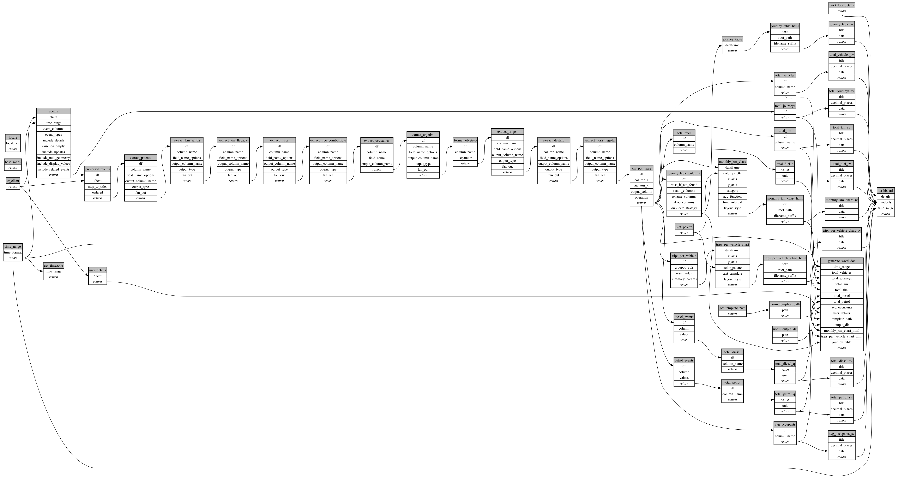

```
# AUTOGENERATED BY ECOSCOPE-WORKFLOWS; see fingerprint in README.md for details

```

```yaml
# fingerprint:
artifacts_sha256_basic: 4ed0ba78f48aedd1ebf4814f666a4ad89e7655f069ce086ce159e6c27f00142d
artifacts_sha256_strict: 453c238e8772502b023cce5553da492f49abfa8ed89286f9c9442649c01ae3f2
installed_requirements:
- channel: https://repo.prefix.dev/ecoscope-workflows/
  name: ecoscope-platform
  version: {version: ==2.28.0}
- channel: https://repo.prefix.dev/ecoscope-workflows-custom/
  name: ecoscope-workflows-ext-custom
  version: {version: ==0.1.0rc23}
- channel: conda-forge
  name: pydeck
  version: {version: ==0.9.2}
- channel: https://repo.prefix.dev/ecoscope-workflows-custom/
  name: ecoscope-workflows-ext-apn
  version: {version: ==0.0.33}
params_sha256: 8478a1048e84d61d7314eedef8a4979cc598bfa72825e8a2ccb20541c5123bd2
spec_sha256: 6993fc288ec9bd10315dc1c57cbac9df3a60ffe4aed170861a77a224cafd47b7

```

# ecoscope-workflows-vehicle-summary-workflow


